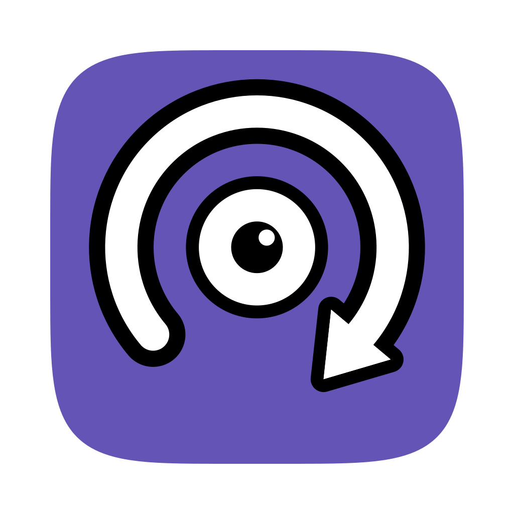
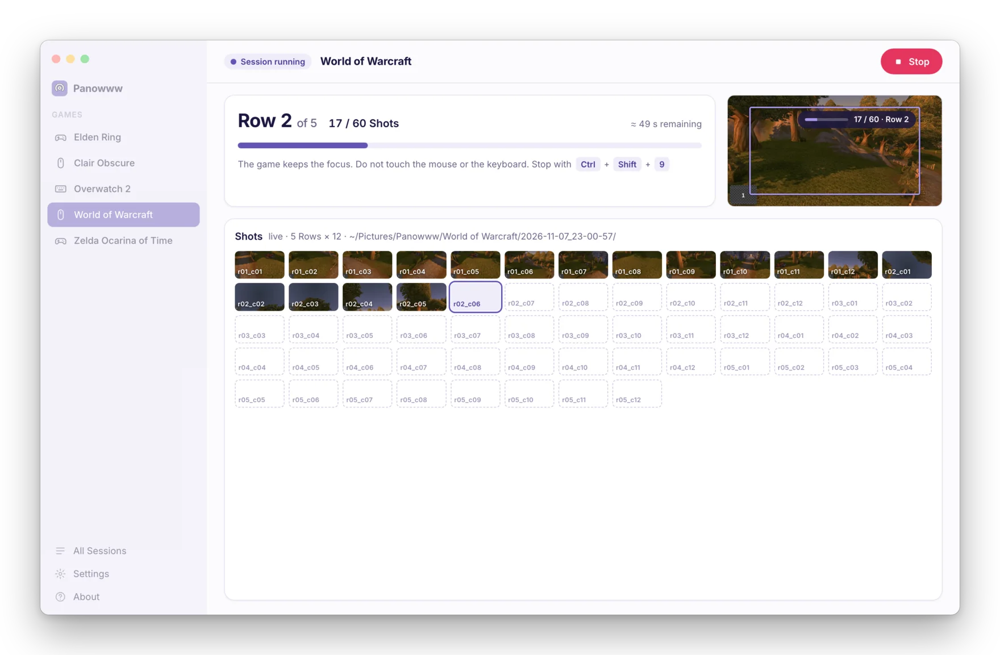
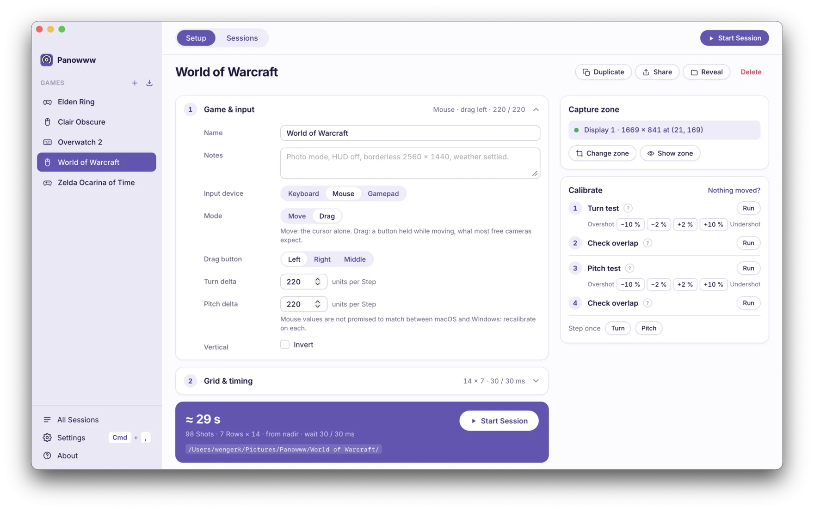
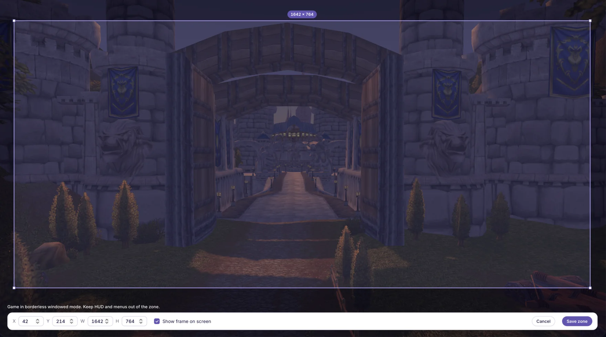
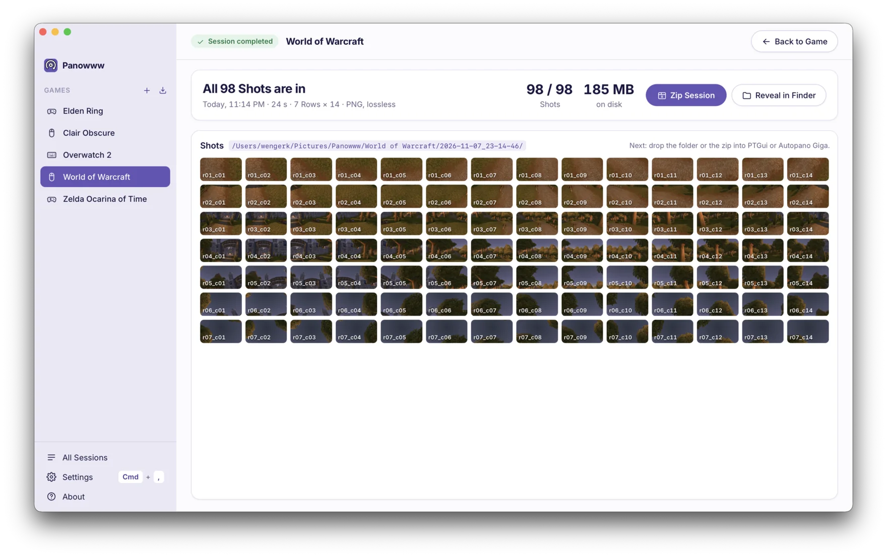

<div align="center">



<h1>Panowww</h1>

<p>Automated 360° panorama capture for video games.</p>

<p>
  <a href="https://github.com/Respawwwn/panowww/releases/latest"></a>
  
  <a href="LICENSE"></a>
  <a href="https://discord.gg/49tS4mVNbp"></a>
</p>

<p>
  <a href="https://github.com/Respawwwn/panowww/releases/latest"></a>
  &nbsp;
  <a href="https://github.com/Respawwwn/panowww/releases/latest"></a>
</p>

<!-- Hero: a static screenshot until the animated hero lands (issue 27). -->


</div>

## Why Panowww

A 360° panorama of a game world is made of dozens of Shots taken from the same spot, turning the camera a little between each one. Doing it by hand means hundreds of key presses, a steady hand and a lot of patience.

Panowww does it for you. You describe once how the camera moves in a game (keys, mouse or gamepad, how far one Step turns, how many Rows), draw the zone of the screen to capture, and start a Session. Panowww turns the camera, takes a lossless Shot after every Step, and leaves a folder ready to stitch in [PTGui](https://ptgui.com) or [Autopano Giga](https://autopanogiga.com/).

New to game panoramas? Watch [How to Create a 360° Panorama in a Video Game](https://www.youtube.com/watch?v=ZR5Tn9tmDEM).

## Screenshots

| | |
|---|---|
|  |  |
| **Set up a Game** once: input, grid and delays. | **Draw the Capture zone** over the game. |
|  |  |
| **Follow the Session** with live thumbnails. | **Every Shot is in**: zip the Session or reveal it, then stitch. |

<!-- Still to take, see docs/readme/README.md:
|  |  |
| **Check overlap** between two Shots before you start. | **The game keeps the focus**: the countdown and progress are drawn over it. |
|  | |
| **Every Session in one list**: zip it, reveal it, delete it. | |
-->

## Quick start

1. **Add a Game**: pick the Input device and the keys or moves that turn the camera.
2. **Draw the Capture zone** over the game, in borderless windowed mode.
3. **Calibrate** with a Turn test and a Pitch test, then Check overlap.
4. **Start a Session** with the shortcut (`Ctrl+Shift+8`) while the game has the focus.
5. **Zip the Session** and stitch it in PTGui or Autopano Giga.

## Requirements

| | macOS | Windows |
|---|---|---|
| System | macOS 14 or later, Apple Silicon | Windows 10 (1903 or later) or 11, x64 |
| Permissions | Accessibility and Screen Recording | Runs as administrator |
| Gamepad Games | Not available | [ViGEmBus 1.22.0](https://github.com/nefarius/ViGEmBus/releases/tag/v1.22.0) |

On both: the game runs in **borderless windowed** mode, and you need a stitching program such as [PTGui](https://ptgui.com) or [Autopano Giga](https://autopanogiga.com/).

## Download

Get the latest version from the [Releases page](https://github.com/Respawwwn/panowww/releases/latest):

| File | For |
|---|---|
| `Panowww.dmg` | macOS 14+, Apple Silicon |
| `Panowww-setup.exe` | Windows 10 / 11, x64 |

## Installation

Panowww is free and open source, and we don't pay Apple or Microsoft to sign it. Your system will warn you the first time you open it: here is how to get past that warning.

### macOS

1. Open `Panowww.dmg` and drag **Panowww** into **Applications**.
2. Open Panowww. macOS says *"Apple could not verify Panowww is free of malware"*. Click **Done**.
3. Open **System Settings → Privacy & Security**, scroll down to the message saying Panowww was blocked and click **Open Anyway**, then confirm with your password.
4. Panowww opens on its welcome window. Grant **Accessibility** (to move the camera) and **Screen Recording** (to capture the zone), then quit and reopen Panowww.

Prefer the terminal? After step 1, run:

```sh
xattr -dr com.apple.quarantine /Applications/Panowww.app
```

On macOS 26, the first capture may ask whether Panowww can bypass the system window picker. Click **Allow** before you start a Session, or the alert lands in your first Shot.

### Windows

1. Run `Panowww-setup.exe`. Windows SmartScreen says *"Windows protected your PC"*: click **More info**, then **Run anyway**.
2. The installer sets Panowww up for your user and downloads WebView2 if your Windows doesn't have it yet.
3. Windows asks for administrator rights **every time** Panowww starts. This is normal: elevated, Panowww can send input to games that run elevated themselves, which Windows would otherwise block.
4. For gamepad Games only, install [ViGEmBus 1.22.0](https://github.com/nefarius/ViGEmBus/releases/tag/v1.22.0). The project is archived but the driver works. Keyboard and mouse Games don't need it.

## FAQ

<details>
<summary><b>Nothing moves during a Test or a Session</b></summary>

Panowww sends the keys and mouse moves but gets nothing back from the game. Check, in this order:

1. The game runs in borderless windowed mode, not exclusive fullscreen.
2. The game had the focus when the countdown ended. Click into it next time.
3. Depending on the Input device:
   - **Keyboard**: the three keys match the game's camera bindings. Panowww presses the key at that position on your keyboard: check them on your layout.
   - **Mouse**: switch between Move and Drag, or try another drag button. Some games read the mouse only after a click inside their window.
   - **Gamepad** (Windows): ViGEmBus is installed and the game accepts an Xbox 360 controller. Unplug physical controllers: the virtual pad must be player 1. Some games only look for controllers at launch: restart the game once after the first countdown.
4. On macOS, some games read the mouse through the game-controller path and ignore injected moves. Use the game's keyboard camera controls if it has them.
   On Windows, some games read the mouse and keyboard straight from the device and ignore injected input. Use a gamepad Game for them.
5. Multiplayer games with anti-cheat block injected input and may ban you for it. Use Panowww offline, in single-player.

</details>

<details>
<summary><b>macOS: the permission is ticked but nothing happens</b></summary>

macOS remembers the permission for an older copy of Panowww. In **System Settings → Privacy & Security**, open **Accessibility** (or **Screen Recording**), remove Panowww with the **–** button, add it again with **+**, then quit and reopen Panowww.

</details>

<details>
<summary><b>macOS: "Apple could not verify Panowww"</b></summary>

Expected: Panowww isn't notarized by Apple. Follow [Installation → macOS](#macos), step 3.

</details>

<details>
<summary><b>Windows: "Windows protected your PC"</b></summary>

Expected: Panowww isn't signed with a paid certificate. Click **More info**, then **Run anyway**.

</details>

<details>
<summary><b>Windows: why does Panowww ask for administrator rights every time?</b></summary>

Windows blocks input sent to a game that runs as administrator unless the sender runs as administrator too. Panowww always asks so that it works with every game.

</details>

<details>
<summary><b>Windows: my gamepad Game says ViGEmBus is missing</b></summary>

Install [ViGEmBus 1.22.0](https://github.com/nefarius/ViGEmBus/releases/tag/v1.22.0), then restart Panowww. Only gamepad Games need it.

</details>

<details>
<summary><b>How do I get the best panoramas?</b></summary>

- **Start at the nadir** (straight down, the default): the first Row is the ground, the last one the sky.
- **Borderless windowed mode**, never exclusive fullscreen.
- **No HUD in the zone**: use the game's photo mode if it has one, or hide the HUD and menus.
- **HDR off**, in Windows or in the game: HDR Shots come out washed out.
- **Aim for 25–35 % Overlap** between neighbouring Shots: Check overlap tells you where you stand.

</details>

## Motivation

[Respawwwn](https://respawwwn.com) is a daily gaming quiz: you guess the game from 360° panoramas, screenshots, sounds and videos. Every panorama in it has to be captured inside the game first.

Nvidia Ansel used to do that for a handful of games, but its 360° capture didn't survive the move to the Nvidia App. We scripted our own captures in Python for a while ([game-pano-capture](https://github.com/Respawwwn/game-pano-capture)), and Panowww is that script grown into one all-in-one tool: set up a Game once, capture, stitch, on macOS and Windows, for any game whose camera you can turn.

## Contributing

Bug reports, Games that don't work, and pull requests are welcome. Read [CONTRIBUTING.md](CONTRIBUTING.md) to set up the project, and open an [issue](https://github.com/Respawwwn/panowww/issues/new/choose) before starting on a large change.

## License

[MIT](LICENSE) © Kevin Wenger (Respawwwn). The Respawwwn name and logo are not covered by the license, see [NOTICE](NOTICE).

Made by [Respawwwn](https://respawwwn.com) · [Discord](https://discord.gg/49tS4mVNbp) · [Ko-fi](https://ko-fi.com/respawwwn)

Panowww is a Respawwwn project by Kevin Wenger.
